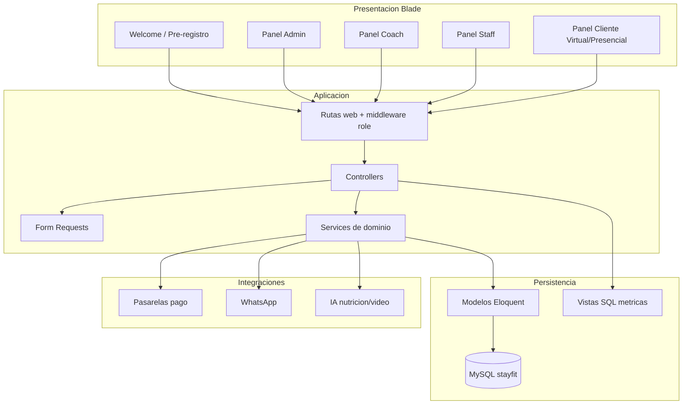
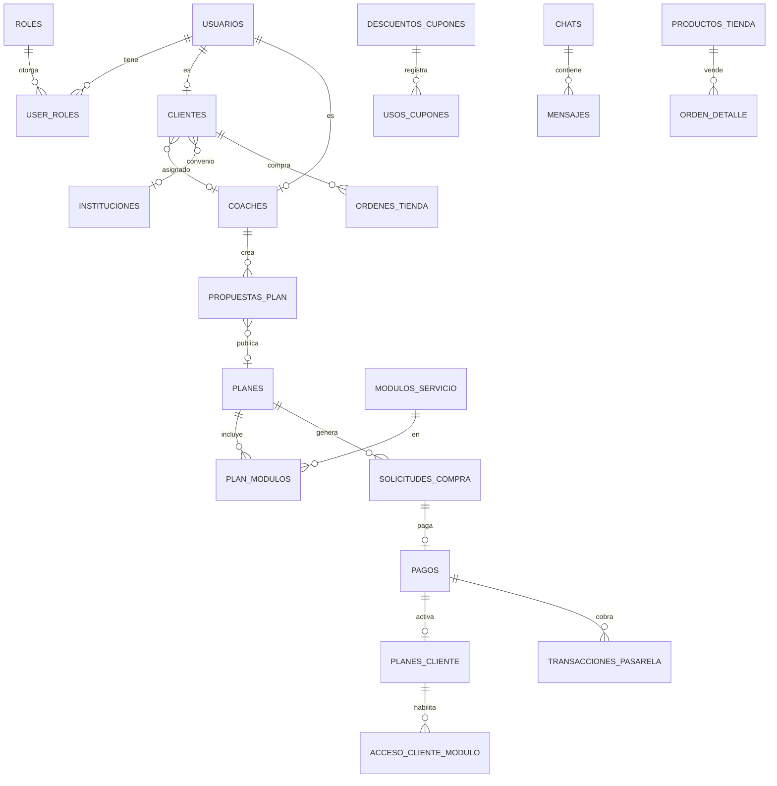

# StayFit / FigueFit — Arquitectura final y plan de implementación

**Versión:** 1.0  
**Fecha:** 2026-08-26  
**Tipo:** Documento técnico de arquitectura (sin código)  
**Fuentes:** StayFit v4.0 (SRS, Integral, CU, HU, BD), auditoría de código Laravel, `GUIA_ORDEN_DESARROLLO_STAYFITT.md`  
**Estado del código de referencia:** monolito Laravel con Admin/Coach/Staff avanzados; Cliente e integraciones reales incompletos

---

## 0. Principios de diseño (no negociables)

1. **No inventar funcionalidades** fuera de RF-001…055 / CU-01…55.
2. **Respetar reglas de negocio v4.0** (formulario ≠ cliente activo; acceso por plan+pago+módulo+vigencia; tienda solo presencial; Virtual=chat / Presencial=WhatsApp).
3. **Secuencia obligatoria del profesor** en cada feature:

```
BD → Modelos → Controladores → Rutas → Vistas → Auth/Permisos → Pruebas
```

4. **Reutilizar** lo ya construido (Admin, solicitudes, propuestas, seeds). No eliminar sin justificación.
5. **Capas claras:** Blade no contiene lógica de negocio; Controllers delegan a Services; Models representan tablas y relaciones.
6. **Entrega defendible:** primero cerrar seguridad + Admin + flujo comercial; luego Cliente; luego integraciones reales o modo demo explícito.

---

## 1. Arquitectura general del sistema

### 1.1 Estilo arquitectónico

| Decisión | Elección |
|---------|----------|
| Estilo | Monolito modular Laravel (MVC) |
| Presentación | Blade + layouts por rol (admin / coach / staff / cliente) |
| Aplicación | Controllers + Form Requests + Services de dominio |
| Persistencia | Eloquent sobre MySQL `stayfit` (esquema v4.0) |
| Seguridad | Sesión `web` + middleware `role` + (fase ulterior) Policies por recurso |
| Integraciones | Adaptadores en `app/Services/Integrations/` (pasarela, WhatsApp, IA) |
| API REST | Fuera de alcance de entrega académica inicial (no `api.php` obligatorio) |

**Patrón de diseño principal:** MVC (Model–View–Controller) con **Service Layer** para reglas de negocio críticas (activación, pagos, cupones, webhooks).

Patrones secundarios ya presentes o a formalizar:

- **Repository implícito** vía Eloquent (no introducir repositorios genéricos innecesarios).
- **DTO/Request objects** = Form Requests Laravel.
- **Strategy** ligera para pasarelas (`PagoPasarelaSimulacionService` → implementaciones reales).
- **Observer/Event** solo cuando haya webhooks/colas (Jobs); no forzar Events prematuros.

### 1.2 Diagrama de capas



### 1.3 Flujo de comunicación entre componentes

1. Usuario → Ruta (`routes/*.php`) con middleware `auth` / `role:*`.
2. Ruta → Controller (orquestación HTTP).
3. Controller → Form Request (validación) → Service (reglas) → Model/DB.
4. Service escribe bitácora / historiales cuando la operación es crítica.
5. Controller → Vista Blade (datos ya preparados; sin queries pesadas en Blade).
6. Integraciones externas solo desde Services (nunca desde Blade).

### 1.4 Organización correcta del proyecto (responsabilidad de carpetas)

```
StayFitt/
├── app/
│   ├── Http/
│   │   ├── Controllers/
│   │   │   ├── Admin/          # Operación administrativa
│   │   │   ├── Coach/          # Asignación de contenido / propuestas
│   │   │   ├── Staff/          # Novedades y apoyo operativo
│   │   │   ├── Cliente/        # Consumo Virtual/Presencial (a completar)
│   │   │   └── Auth/           # Login, recovery
│   │   ├── Middleware/         # EnsureRole (+ EnsureModalidad futuro)
│   │   └── Requests/           # Validaciones por caso de uso
│   ├── Models/                 # 1 modelo ≈ 1 tabla de dominio
│   ├── Services/               # Reglas de negocio y orquestación
│   │   └── Integrations/       # Adaptadores externos (nuevo, formalizar)
│   ├── Support/                # Traits/helpers de presentación
│   └── View/                   # View composers (header badges)
├── bootstrap/                  # Registro de middleware alias
├── config/                     # auth, app, stayfit (flags demo/live)
├── database/
│   ├── migrations/             # Fuente de esquema Laravel
│   └── seeders/                # Demo reproducible
├── resources/views/
│   ├── layouts/                # app, admin, coach, staff, cliente, auth
│   ├── admin/ | coach/ | staff/ | cliente/ | auth/
│   └── welcome / pre-registro / registro-presencial
├── routes/
│   ├── web.php                 # Público + includes
│   ├── auth.php
│   ├── admin.php
│   ├── coach.php
│   ├── staff.php
│   └── cliente.php             # A crear/formalizar
├── docs/                       # Arquitectura, guía, login, admin
└── StayFitDocumentación/       # SRS, CU, HU, BD canónica
```

**Archivos mal ubicados a corregir en fase de estructura (sin cambiar lógica aún):**

- `_list_staff_users.php`, `_build_stayfit_excel.py` → mover a `scripts/` o excluir de deploy.
- `ModuloProximoController` → eliminar cuando todos los módulos reales estén enlazados.
- Migraciones stub `2026_03_01_*` → documentar como históricas; no reactivar.

---

## 2. Diseño de módulos del sistema

### 2.1 Módulo administrativo

**Propósito:** operar el negocio FigueFit: catálogo, personas, solicitudes, pagos, configuración y supervisión.

#### Tablas necesarias (ya en BD v4)

| Dominio | Tablas |
|---------|--------|
| Auth | `usuarios`, `roles`, `user_roles`, `tokens_recuperacion`, `sesiones_auth` |
| Personas | `clientes`, `coaches`, `instituciones`, `historial_*`, `medidas_antropometricas_iniciales` |
| Catálogo | `planes`, `modulos_servicio`, `plan_modulos`, `horarios`/`disponibilidades` según uso actual |
| Comercial | `solicitudes_compra`, `pagos`, `planes_cliente`, `acceso_cliente_modulo`, `facturas` |
| Config | `configuracion_pasarelas`, `configuracion_whatsapp`, `configuracion_sistema` |
| Agenda | `sesiones`, `eventos`, `asistencias` |
| Auditoría | `bitacora_sistema`, `reportes_generados` |

#### Modelos

`User`, `Rol`, `UserRole`, `Cliente`, `Coach`, `Institucion`, `Plan`, `ModuloServicio`, `SolicitudCompra`, `Pago`, `PlanCliente`, `AccesoClienteModulo`, `DescuentoCupon`, `ConfiguracionPasarela`, `ConfiguracionWhatsapp`, `Evento`, `Sesion`, `ProductoTienda`, `OrdenTienda`, `Chat`, `Mensaje`, `ReporteGenerado`, `BitacoraSistema`, …

#### Controladores (objetivo final Admin)

| Controller | Responsabilidad | CRUD / acciones |
|------------|-----------------|-----------------|
| `DashboardController` | KPIs | R |
| `UsuarioController` | Identidad + roles (sin escalada indebida) | R/U + reset password |
| `ClienteController` | Expedientes virtual/presencial | R/U/D + coach + accesos |
| `CoachController` | Alta/edición coaches | C/R/U/(soft)D |
| `AsistenteController` | Staff técnico | CRUD |
| `InstitucionController` | Convenios + enlaces | CRUD + vincular |
| `PlanController` | Catálogo comercial | CRUD |
| `PropuestaPlanController` | Publicar/rechazar | R + workflow |
| `CuponController` | Cupones | CRUD + usos |
| `SolicitudController` | Aprobar/rechazar/suspender | R + acciones |
| `PagoController` | Listado + detalle + anular/validar coherente | R + acciones |
| `PasarelaController` | Config + modo SANDBOX/LIVE | R/U |
| `TiendaController` | Productos + órdenes | CRUD productos + U órdenes |
| `WhatsappController` | Config + grupos | R/U + CRUD grupos |
| `ComunidadController` | Supervisión chats | R (+ moderación mínima) |
| `EventoController` / `CalendarioController` | Agenda | CRUD |
| `HorarioPresencialController` | Cupos horarios | CRUD |
| `EstadisticaController` / `ReporteController` | Análisis | R + export |
| `ConfiguracionController` *(nuevo si falta)* | `configuracion_sistema` | R/U |

#### Rutas

Prefijo `/admin`, middleware `auth` + `role:ADMIN`, archivo [`routes/admin.php`](../routes/admin.php).  
Nombres `admin.*` estables (no romper menú existente).

#### Vistas

`resources/views/admin/**` + `layouts/admin.blade.php`.  
Una vista por listado/detalle/formulario; modales aceptables si ya es patrón del proyecto (planes/cupones).

#### Auth / roles / permisos (diseño)

| Nivel | Mecanismo |
|-------|-----------|
| Autenticación | Guard `web`, `usuarios.correo` + `password_hash` |
| Autorización gruesa | Middleware `role:ADMIN` (y grupos coach/staff) |
| Autorización fina | Policies en fase de seguridad (pago, cliente, propuesta) |
| Regla | Solo ADMIN puede asignar rol ADMIN; reset password desde Admin |

---

### 2.2 Módulo comercial

#### 2.2.1 Planes

| Ítem | Definición |
|------|------------|
| Funcionalidad | Catálogo ACTIVO/INACTIVO, cupos, módulos, precios, imagen, flags |
| Flujo Admin | Listar → Crear/Editar → Sync `plan_modulos` → Soft-deactivate si hay clientes |
| Flujo Visitante | Welcome muestra planes → Pre-registro o Presencial |
| Datos | nombre, slug, precio, cupo, modalidad, estado, módulos N:M |
| CRUD | Completo (destroy = desactivar si hay FK) |
| Relaciones | `Plan` N:M `ModuloServicio`; 1:N solicitudes, planes_cliente, propuestas |

#### 2.2.2 Propuestas

| Ítem | Definición |
|------|------------|
| Funcionalidad | Coach arma propuesta (videos + nutrición) → Admin publica como Plan |
| Flujo | Borrador → Envío → Revisión → Publicar / Rechazar |
| Datos | `propuestas_plan`, vínculos a programa/nutrición |
| CRUD | Coach C/U borrador; Admin R + publicar/rechazar |
| Relaciones | `PropuestaPlan` → Coach, ProgramaVirtual, PlanNutricional, Plan publicado |

#### 2.2.3 Novedades

| Ítem | Definición |
|------|------------|
| Funcionalidad | Banner/cards en Welcome con vigencia e imagen |
| Flujo | Staff/Admin CRUD → visible en `/` si fechas OK |
| Datos | `novedades_welcome` (+ plan opcional) |
| CRUD | Completo en Staff (`/staff/novedades`) |
| Relaciones | opcional `belongsTo Plan`, `creador` |

#### 2.2.4 Cupones

| Ítem | Definición |
|------|------------|
| Funcionalidad | Descuento % o valor fijo en compra; usos máximos y vigencia |
| Flujo | Admin crea → Cliente aplica en checkout → `usos_cupones` → recalcula pago |
| Datos | código, tipo, valor, plan opcional, fechas, usos, estado |
| CRUD | Completo + listado usos |
| Relaciones | `DescuentoCupon` → Plan; `UsoCupon` → cupón + solicitud |

**Estado actual:** Admin parcial; **falta efecto en compra** (prioridad alta).

#### 2.2.5 Tienda (solo presencial)

| Ítem | Definición |
|------|------------|
| Funcionalidad | Catálogo productos; carrito; orden; Admin gestiona stock/estados |
| Flujo Cliente | Ver productos → Carrito → Checkout (pasarela/simulación) → Orden |
| Flujo Admin | CRUD producto → Ver órdenes → Cambiar estado + comprobante |
| Datos | categorías, productos, variantes, carritos, items, órdenes, detalle, alertas |
| CRUD | Admin productos; Cliente carrito/orden |
| Relaciones | `ProductoTienda` 1:N variantes/items; `OrdenTienda` 1:N detalle |

#### 2.2.6 Pasarelas

| Ítem | Definición |
|------|------------|
| Funcionalidad | Cobro online + webhook firmado → activación idempotente |
| Flujo A | Checkout → redirect/pasarela → webhook APPROVED → `SolicitudAprobacionService` |
| Flujo B | Comprobante → Admin valida (ya existe) |
| Datos | `configuracion_pasarelas`, `transacciones_pasarela`, `eventos_webhook`, `intentos_activacion` |
| CRUD | Admin R/U config; Sistema C transacciones/webhooks |
| Relaciones | Transacción → Pago / Solicitud |

**Entrega:** si no hay integración real, UI debe etiquetar **DEMO/SANDBOX** y no “LIVE productivo”.

---

### 2.3 Módulo comunicación

#### 2.3.1 WhatsApp (presencial)

| Ítem | Definición |
|------|------------|
| Gestión | Config número/horario/mensaje; grupos con link; invitaciones post-activación |
| Usuarios | Admin configura; Cliente presencial recibe invitación; Sistema dispara alert |
| Permisos | Solo ADMIN edita config; Cliente solo ve/usa link de su grupo |
| Integración | Fase 1: links manuales; Fase 2: API Meta (token cifrado) opcional |

Tablas: `configuracion_whatsapp`, `grupos_whatsapp`, `participantes_grupo_whatsapp`, `invitaciones_whatsapp`.

#### 2.3.2 Comunidad / Chat (virtual)

| Ítem | Definición |
|------|------------|
| Gestión | Chat por plan/coach; mensajes; participantes; Admin supervisa |
| Usuarios | Cliente Virtual, Coach, Admin (lectura) |
| Permisos | Solo participantes escriben; Admin lee/modera |
| Integración | Polling o Livewire/Echo futuro; MVP = request/response |

Tablas: `chats`, `chat_participantes`, `mensajes`, `notificaciones`.

---

### 2.4 Módulo análisis

#### Estadísticas

| Ítem | Definición |
|------|------------|
| Indicadores | Clientes activos, solicitudes pendientes, ingresos, cupos por plan, modalidad |
| Fuentes | `vw_dashboard_metricas`, `vw_cupos_planes`, `vw_ingresos_pasarela`, `pagos`, `clientes` |
| Visualización | Cards + gráficos (Barras/donut existentes); filtros por rango de fechas |

#### Reportes

| Ítem | Definición |
|------|------------|
| Tipos mínimos | Pagos, clientes, cupos (+ tienda/solicitudes si alcanza) |
| Proceso | Admin elige tipo/filtros → genera CSV/PDF → registra `reportes_generados` |
| Fuentes | Tablas transaccionales + vistas SQL |
| Visualización | Tabla previa + descarga |

---

## 3. Diseño lógico de base de datos

### 3.1 Decisión

**No se rediseña el esquema desde cero.** La BD canónica es `StayFitDocumentación/BD/stayfit.sql` (~77 tablas + vistas), ya migrada en `database/migrations/2026_08_16_*`.

Trabajo de BD en el plan = **validar, completar relaciones Eloquent, unificar lectura de columnas duales, y migraciones aditivas mínimas** solo si un RF lo exige.

### 3.2 Dominios y cardinalidades (resumen)



### 3.3 Relaciones clave

| Relación | Tipo | Tablas |
|----------|------|--------|
| Usuario–Rol | N:M | `user_roles` |
| Usuario–Cliente / Coach | 1:1 | `clientes.id_user`, `coaches.id_user` |
| Plan–Módulo | N:M | `plan_modulos` |
| Plan–Solicitud–Pago–PlanCliente | 1:N / 1:1 | cadena comercial |
| PlanCliente–Acceso | 1:N | `acceso_cliente_modulo` |
| Cupón–Uso–Solicitud | 1:N | `usos_cupones` |
| Chat–Participantes | N:M | `chat_participantes` |
| Carrito–Items–Producto | 1:N | tienda |
| Sesión–Participantes / Asistencias | 1:N | agenda |

### 3.4 Campos / PK / FK

- PK de dominio: `id_*` (p. ej. `id_user`, `id_plan`, `id_cliente`) según migraciones.
- FK con `onDelete` ya definidos en migraciones; **no cambiar** sin análisis de impacto.
- Columnas duales (`estado`/`estado_cuenta`, `codigo`/`codigo_rol`, …): estrategia = **accessors/mutators o lectura unificada en Model**, no migración destructiva en entrega.

### 3.5 Vistas SQL a conservar

`vw_cupos_planes`, `vw_clientes_activos`, `vw_pagos_por_estado`, `vw_accesos_vigentes`, `vw_progreso_resumen`, `vw_ingresos_pasarela`, `vw_asistencia_racha`, `vw_dashboard_metricas`.

---

## 4. Flujos de usuario por módulo

### 4.1 Administrador (transversal)

```
Login → Dashboard → Selecciona módulo → Lista/Detalle → Crear/Editar/Eliminar o Acción
  → Validación → Persistencia (+ bitácora si aplica) → Flash OK/Error → Reportes
```

### 4.2 Comercial — Camino compra (Visitante → Cliente)

```
Welcome → Elige plan → (Cupón opcional) → Pre-registro Virtual | Registro Presencial
  → Pago (pasarela DEMO o comprobante) → Solicitud PENDIENTE
  → [Pasarela APPROVED] activación automática
  → [Comprobante] Admin aprueba/rechaza
  → usuarios+rol CLIENTE + clientes + planes_cliente + acceso_cliente_modulo
  → Redirect dashboard según modalidad
```

### 4.3 Coach — Propuestas / contenido

```
Login → /coach → Propuesta (entrenamiento → nutrición) → Enviar
  → Admin revisa → Publica plan o rechaza
  → (Fase Cliente) asigna rutinas/planes a clientes asignados
```

### 4.4 Cliente Virtual

```
Login → Dashboard Virtual → Menú solo módulos con acceso vigente
  → Entrenamiento / Videos / Nutrición / Progreso / Agenda / Chat / Pagos
  → Acciones permitidas → Feedback
```

### 4.5 Cliente Presencial

```
Login → Dashboard Presencial → Asistencia/Agenda → WhatsApp → Tienda → Perfil/Pagos
```

### 4.6 Comunicación

```
Virtual: Cliente/Coach abren chat → envían mensaje → notificaciones
Presencial: Activación → Sistema/Admin genera invitacion WhatsApp → Cliente usa link
Admin: Comunidad (lectura) / WhatsApp (config)
```

### 4.7 Análisis

```
Admin → Estadísticas (filtros) → interpreta KPIs
Admin → Reportes → elige tipo/rango → exporta → historial reportes_generados
```

---

## 5. Plan de implementación (fases de construcción)

Cada feature interna sigue: **BD → Modelo → Controller → Ruta → Vista → Auth → Prueba**.

### FASE 1 — Corrección de estructura base

| | |
|--|--|
| **Objetivo** | Limpiar organización sin romper funcionalidad |
| **Archivos** | scripts raíz → `scripts/`; docs; quitar dead code cuando sea seguro; alinear `GUIA` con estado real Coach |
| **Dependencias** | Ninguna |
| **Resultado** | Repo ordenado; guía de fases actualizada |

### FASE 2 — Base de datos

| | |
|--|--|
| **Objetivo** | Confirmar esquema soporte todos los módulos; migraciones aditivas mínimas |
| **Archivos** | `database/migrations/*`, vistas SQL, seeders |
| **Dependencias** | Fase 1 |
| **Resultado** | BD alineada a RF; sin stubs activos nuevos; seeds demo estables |

### FASE 3 — Modelos

| | |
|--|--|
| **Objetivo** | Completar relaciones faltantes y lectura unificada de columnas duales |
| **Archivos** | `app/Models/*` (Plan, Carrito, Chat, PlanCliente, Rol, …) |
| **Dependencias** | Fase 2 |
| **Resultado** | Modelos listos para Controllers sin queries ad-hoc rotas |

### FASE 4 — Controladores + Services

| | |
|--|--|
| **Objetivo** | Cerrar lógica Admin incompleta + Comercial (cupones) + shells Cliente |
| **Archivos** | `app/Http/Controllers/{Admin,Cliente,Coach}/*`, `app/Services/*` |
| **Dependencias** | Fase 3 |
| **Resultado** | Casos de uso orquestados; reglas en Services |

**Orden de Controllers sugerido:**  
Seguridad/auth → Pagos Admin → Cupones checkout → Usuario/roles → Cliente shell → Tienda cliente → Chat/WhatsApp → Reportes.

### FASE 5 — Rutas

| | |
|--|--|
| **Objetivo** | Exponer endpoints con middleware correcto |
| **Archivos** | `routes/admin.php`, `coach.php`, `staff.php`, `cliente.php` (nuevo), `web.php`, `auth.php` |
| **Dependencias** | Fase 4 |
| **Resultado** | Mapa de URLs estable; sin rutas huérfanas |

### FASE 6 — Interfaces (Vistas)

| | |
|--|--|
| **Objetivo** | UI coherente FigueFit; sin botones muertos |
| **Archivos** | `resources/views/admin|coach|staff|cliente|layouts/*` |
| **Dependencias** | Fase 5 |
| **Resultado** | Flujos usables en desktop/móvil |

### FASE 7 — Seguridad (Auth y permisos)

| | |
|--|--|
| **Objetivo** | Alinear código a reglas documentales |
| **Trabajo** | Cerrar registro público; password inicial seguro; bloquear escalada ADMIN; Policies; tokens_recuperacion; bitácora en acciones críticas |
| **Archivos** | Auth controllers, `EnsureRole`, Policies, `User`, Services de aprobación |
| **Dependencias** | Fases 4–6 (puede solaparse temprano en P0) |
| **Resultado** | Authz defendible en entrega |

### FASE 8 — Pruebas

| | |
|--|--|
| **Objetivo** | Verificar caminos A/B/C, Admin CRUD, Coach propuesta, Cliente menú |
| **Archivos** | `tests/Feature/*` + checklist manual en docs |
| **Dependencias** | Fases 1–7 |
| **Resultado** | Checklist de entrega pasado |

### FASE 9 — Optimización final

| | |
|--|--|
| **Objetivo** | UX, queries N+1, mensajes flash, README, etiquetar DEMO |
| **Archivos** | vistas, composers, README, config |
| **Dependencias** | Fase 8 |
| **Resultado** | Versión lista para presentación/producción controlada |

---

## 6. Orden exacto de programación (cola de trabajo)

Prioridad fija para la versión de entrega:

| # | Entrega | RF/CU ancla | Secuencia técnica |
|---|---------|-------------|-------------------|
| 1 | P0 Seguridad auth/roles/passwords | RF-001…006, CU-04…06 | Modelo User → Controllers Auth/Usuario → Rutas → Vistas → Prueba login |
| 2 | P1 Admin pagos detalle + cupones CRUD completo | RF-028…035, CU-28…34 | Modelos Pago/Cupon → Controllers → Rutas → Vistas → Prueba |
| 3 | P2 Cupones en checkout (pre-registro + presencial) | RF cupones + compra | Service descuento → Controllers compra → Vistas → Prueba monto |
| 4 | P3 Router Cliente Virtual/Presencial | RF acceso, CU-31 | Middleware modalidad → Controllers Cliente → Rutas → Layouts → Prueba redirect |
| 5 | P4 Menú por `acceso_cliente_modulo` + perfil | RF-031, CU-35 | Modelo Acceso → Controller menú → Vistas → Prueba sin acceso |
| 6 | P5 Consumo mínimo (1 rutina o videos del plan) | RF-010…016 / videos | Modelos training → Coach assign + Cliente consume → Prueba punta a punta |
| 7 | P6 WhatsApp invitaciones post-activación | RF-052, CU-52 | Modelos WA → Service en aprobación → Admin UI → Prueba |
| 8 | P7 Chat virtual mínimo | RF-036…037, CU-36 | Modelos Chat → Controllers Cliente/Coach → Vistas → Prueba |
| 9 | P8 Tienda cliente presencial | RF-051, CU-51 | Modelos carrito → Controllers → Rutas → Vistas → Prueba orden |
| 10 | P9 Pasarela: DEMO explícito o webhook real | RF-050, CU-50 | Service Integration → Rutas webhook → Prueba idempotencia |
| 11 | P10 Estadísticas filtros + reportes | RF-046…049, CU-47…49 | Controllers → Vistas → Export → Prueba |
| 12 | P11 Limpieza, docs, seeds, checklist entrega | — | README + guía + scripts |

**Fuera de alcance inmediato (documentar como pendiente post-entrega si el tiempo no alcanza):** IA nutrición/video (RF-021, validación video), suscripciones recurrentes completas, 2FA, API REST, realtime WebSockets.

---

## 7. Validación contra requisitos

### 7.1 Cubiertos o casi cubiertos (con código actual + este plan)

| Bloque | IDs | Cobertura planificada |
|--------|-----|------------------------|
| Acceso | 001–006 | P0 + recovery |
| Perfil/coach admin | 007–009, 053 | Admin existente + P4 perfil |
| Pagos manuales + catálogo | 028–035, 034 | Admin + P1/P2 |
| Agenda admin | 040–045 | Ya en Admin |
| Instituciones | 054–055 | Ya en Admin |
| Reportes base | 046–049 | P10 |
| Propuestas→Planes | parcial entrenamiento | Coach existente + P5 |

### 7.2 Pendientes críticos (deben entrar a entrega)

| Requisito | Gap | Fase plan |
|-----------|-----|-----------|
| Sin registro público cliente | Register Breeze activo | P0 |
| Cupones en compra | No aplican descuento | P2 |
| Acceso por módulo | Sin menú Cliente | P3–P4 |
| Chat virtual | Solo lectura Admin | P7 |
| WhatsApp post-alta | Solo config | P6 |
| Tienda presencial cliente | Solo Admin | P8 |
| Pasarela real o DEMO claro | LIVE simulado | P9 |
| Password seguro post-activación | = documento | P0 |

### 7.3 Pendientes diferibles (post-MVP entrega)

IA, facturas PDF automáticas, bitácora UI completa, renovaciones/suscripciones, realtime chat, SDKs pasarela producción.

### 7.4 Cambios necesarios vs documentación

1. Actualizar guías: Coach **ya existe** (propuestas); marcar fases 3/9 parciales.
2. Unificar conteo de tablas a **~77** (no 48).
3. Alinear lista de pasarelas UI ↔ SRS o documentar subset implementado.
4. README: quitar boilerplate Laravel; apuntar a `docs/ARQUITECTURA_FINAL_STAYFIT.md`.

### 7.5 Trazabilidad de trabajo

Toda tarea nueva debe citar: **RF + CU + tablas + fase de esta arquitectura**.  
Fuente Excel: `StayFit_Historias_de_Usuario.xlsx` → hoja `Matriz_Trazabilidad`.

---

## 8. Entregable — checklist de “versión completa para entrega”

- [ ] Login por rol → Admin / Coach / Staff / Cliente
- [ ] No alta pública indebida de clientes
- [ ] Tres caminos de compra (A simulado/DEMO, B comprobante, C presencial) activan accesos
- [ ] Admin: planes, propuestas, novedades, cupones con efecto, personas, solicitudes, pagos detalle, tienda backoffice, WA config, comunidad supervisión, stats/reportes
- [ ] Cliente: dashboard por modalidad + menú por accesos + al menos un módulo de consumo
- [ ] Coach: propuestas + asignación mínima de contenido
- [ ] Seguridad: passwords, roles, CSRF, middleware
- [ ] Docs alineadas + seeds demo + checklist de pruebas manuales

---

## 9. Próximo paso (cuando se autorice código)

1. Confirmar alcance de entrega: **P0→P5 mínimo académico** o **P0→P11 completo**.
2. Empezar **P0 Seguridad** siguiendo BD→Modelo→Controller→Ruta→Vista→Prueba.
3. Antes de cada archivo tocado: explicar qué cambia y por qué (regla del líder técnico).

---

*Documento de arquitectura. No modifica código de aplicación.*
